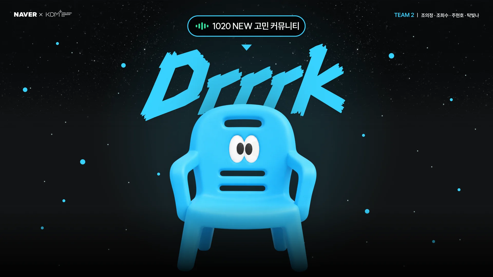
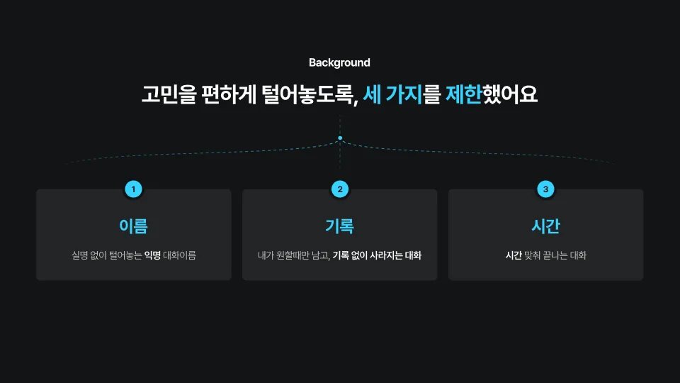
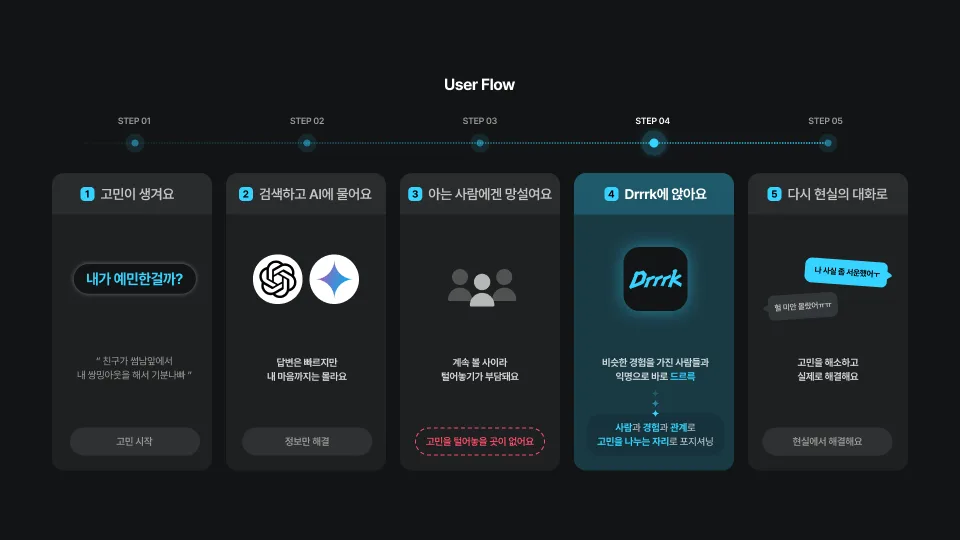

<div align="center">

**Naver x Korea Design Membership Plus(KDM+) 통합 산학 프로젝트**<br/>


# DRRRK

1020 세대를 위한 실시간 고민 커뮤니티<br/>
편의점 앞 의자를 끌어다 앉듯<br/>
비슷한 고민을 가진 사람과 익명으로 마주 앉는 대화 공간




</div>

## 목차

- [서비스 소개](#서비스-소개)
- [핵심 경험](#핵심-경험)
- [기능](#기능)
- [기술 스택](#기술-스택)
- [프로젝트 구조](#프로젝트-구조)
- [시작하기](#시작하기)
- [배포](#배포)
- [문서](#문서)
- [팀](#팀)

## 서비스 소개

| 용어 | 뜻 |
| --- | --- |
| 드르륵 | 편의점 앞 플라스틱 의자를 꺼내 앉는 소리를 나타내는 1020 신조어 |
| 진실의 의자 | 앉으면 진실만 말하게 된다고 해서 붙은 별칭 |
| DRRRK | 그 자리를 앱 안으로 옮겨<br/>고민을 입력하면 맥락이 맞는 사람과 이어 주는<br/>실시간 음성과 채팅 커뮤니티 |

| 구분 | 내용 |
| --- | --- |
| 해결하는 문제 | 콘텐츠를 보다가 "내 얘기 같다"고 공감한 순간<br/>대화 상대를 찾지 못해 다른 플랫폼으로 떠나는 흐름을<br/>네이버 안 실시간 대화로 연결 |
| 대상 | 고민을 부담 없이 털어놓고<br/>깊이 이해받고 싶은 1020 세대 |

**부담 없이 털어놓는 대화를 만드는 세 가지 규칙**

| 규칙 | 내용 |
| --- | --- |
| 이름 | 실명 없이 쓰는 익명 대화 이름 |
| 기록 | 원할 때만 남고 그러지 않으면 사라지는 대화 |
| 시간 | 해가 뜨면 끝나는 20분 안팎의 대화 |

<div align="center"></div>

## 핵심 경험

**고민 입력에서 마무리까지 이어지는 다섯 단계**

| 단계 | 하는 일 |
| --- | --- |
| 고민 입력 | 지금 떠오른 고민을 한 줄로 입력 |
| 방 찾기 | AI가 고민의 주제와 맥락을 분석해<br/>비슷한 경험을 가진 사람이 모인 방을 추천 |
| 앉기 | 추천받은 방에 의자를 끌어다 앉으며<br/>익명의 사람들과 대화를 시작 |
| 대화 | 음성이나 채팅으로 이야기하고<br/>이모지로 반응하고 주전부리를 던지며 어울림 |
| 마무리 | 해가 뜨면 대화가 끝나고<br/>나눈 이야기가 AI 리포트로 정리됨 |

<div align="center"></div>

**확장 경험**

| 영역 | 내용 |
| --- | --- |
| 커뮤니티 | 지난 대화 다시 보기와 의견 보태기 |
| 라이브 | 관심 주제의 영상을 듣다가 같이 앉기 |
| 혼자 드르륵 | 사람이 없을 때 AI 의자와 먼저 대화<br/>비슷한 사람이 나타나면 함께 옮겨 앉기 |
| 마이 | 잘 들어줄수록 오르는 엉따 온도<br/>업적과 의자 스킨 모으기 |

## 기능

| 영역 | 기능 |
| --- | --- |
| 홈과 클립 | 클립 영상 피드, 고민 입력, AI 고민 분석 |
| 방 | 실시간 음성과 채팅, 현장 모드와 일반 모드, 발화 표시, 해 뜨기 시계 |
| 혼자 방 | AI 의자와 먼저 대화, 비슷한 사람 등장 시 함께 방으로 이동 |
| 주전부리 | 간식을 꺼내 던지는 반응, 퀵슬롯과 쿨타임 |
| 리포트 | 대화 종료 리포트, 엉따 온도 변화, 공유 선택 |
| 커뮤니티 | 카테고리와 정렬, 명예의 전당, 글 상세와 대화 다시 보기 |
| 라이브 | 카테고리 캐러셀, 방 구경과 바로 앉기 |
| 마이 | 엉따 온도 게이지, 업적 편의점, 의자 꾸미기와 스킨 |
| 알림 | 활동 알림, 키워드 알림과 관리 |
| 온보딩 | 함께 드르륵과 혼자 드르륵 안내 |
| 소리와 영상 | 입장과 해뜨기, 클립 영상, 아이템 소리, 음성 받아쓰기 |

## 기술 스택

### Languages


### Frameworks and Services


### Design and Tools


주요 의존성

| 영역 | 이름 | 쓰임 |
| --- | --- | --- |
| 웹 | `react`, `react-dom` | 화면 렌더링 |
| 웹 | `react-router-dom` | 화면 전환 라우팅 |
| 웹 | `vite` | 개발 서버와 번들 빌드 |
| 웹 | `tailwindcss`, `postcss`, `autoprefixer` | 유틸리티 스타일과 CSS 변환 |
| iOS | SwiftUI | 화면과 상태 구성 |
| iOS | AVFoundation, AVKit | 아이템 소리와 방 영상 재생 |
| iOS | Speech | 방 입력칸 음성 받아쓰기 |
| iOS | Observation | 화면 상태 관찰과 갱신 |

## 프로젝트 구조

```
client/                 웹 프로토타입
  src/
    main.jsx            앱 들머리
    tokens.js           색과 모션, 크기 토큰
    app/                화면 연결과 전환, 영역별 동작
    figma/              피그마에서 생성한 화면과 컴포넌트
    assets/             아이콘과 SVG 대응표
    styles/             피그마 변수로 만든 CSS 변수와 글자, 효과
  public/               그림과 SUIT 글꼴
  package.json          의존성과 스크립트
  vite.config.js        빌드 설정
ios/                    SwiftUI 앱
  DRRRK/
    App/                들머리와 루트, 라우터, 화면 등록
    DesignSystem/       피그마 값에서 옮긴 토큰
    Features/           홈과 클립, 방, 혼자 방, 커뮤니티, 라이브, 마이, 알림, 온보딩
    Resources/          이미지와 글꼴, 소리, 영상, 더미 데이터
  project.yml           XcodeGen 프로젝트 정의
  run.sh                빌드와 시뮬레이터 실행
  Config/               서명 설정
  RULES.md              iOS 화면 규칙
.github/workflows/      웹 빌드 자동화
docs/                   표지와 흐름 이미지
FLOW.md                 웹 화면 연결표
```

## 시작하기

### 웹

```bash
cd client
npm install
npm run dev
npm run build
```

| 명령 | 내용 |
| --- | --- |
| `npm run dev` | 개발 서버 실행 |
| `npm run build` | 운영 번들 빌드 |
| `npm run preview` | 빌드 결과 미리보기 |

### iOS

| 준비 | 내용 |
| --- | --- |
| 환경 | macOS, Xcode, XcodeGen |

```bash
cd ios
xcodegen generate
open DRRRK.xcodeproj
```

`ios/run.sh`는 프로젝트를 다시 만들고 시뮬레이터용으로 빌드함. 화면 이름을 주면 그 화면으로 바로 띄우고 스크린샷을 남김.

```bash
DEV="iPhone 17" ios/run.sh build home
```

## 배포

웹은 Vercel에 올림. `main`이 운영 도메인 `drrrk.vercel.app`, `dev`는 미리보기 배포.

## 문서

- [FLOW.md](FLOW.md) 웹 화면마다 누르는 곳과 가는 화면, 전환 종류
- [ios/RULES.md](ios/RULES.md) iOS 화면 값과 규칙

## 팀

Naver x Korea Design Membership Plus(KDM+) 통합 산학 프로젝트 Team 2

| 이름 | 역할 |
| --- | --- |
| 조의정 | PL, UX/UI Designer |
| 조희수 | UX/UI Designer |
| 주현호 | UX/UI Designer, Developer |
| 탁빛나 | Visual / Brand Designer |
